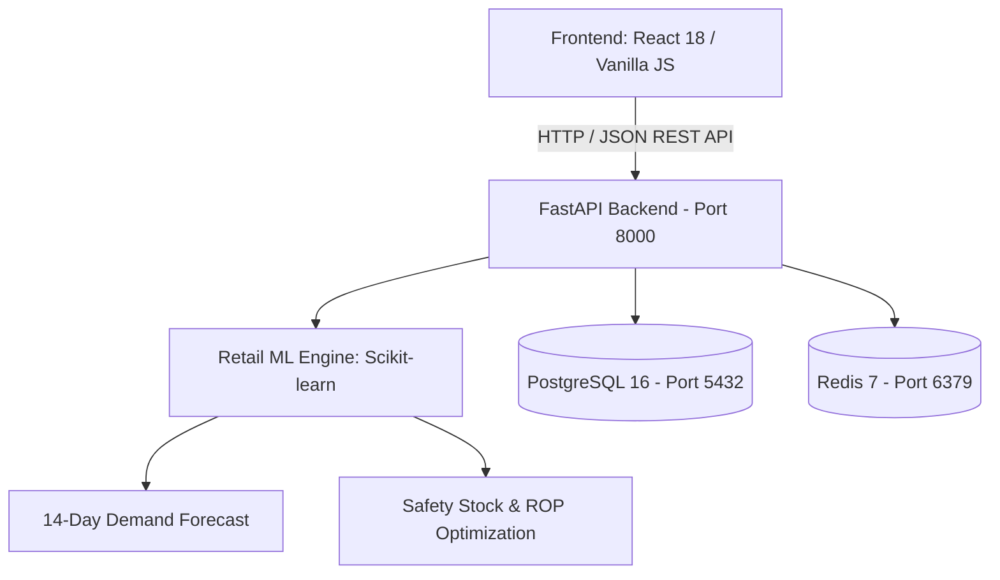

# AI-Powered Smart Retail Inventory Prediction & Demand Forecasting Platform 🇮🇳

An enterprise-grade, end-to-end Machine Learning platform engineered specifically for **Indian Retail & FMCG operations**. The platform forecasts daily customer demand, optimizes inventory replenishment across multi-city store hubs, automates purchase orders, and prevents stockouts using chronological machine learning models.

---

## 🌟 Key Features

1. **Indian Retail & FMCG Catalog**:
   - All currencies in **Indian Rupees (₹)**.
   - Realistic Indian consumer goods: *Aashirvaad Atta, Amul Butter, Tata Tea Gold, boAt Earbuds, Prestige Cookware*, and custom added products (*Cadbury Dairy Milk, Fortune Oil, Maggi*, etc.).
   - Multi-store presence across **Mumbai (Bandra West Flagship)**, **Bengaluru (Koramangala Hub)**, and **Delhi NCR (Connaught Place)**.

2. **Accurate Demand Forecasting**:
   - Multiple forecasting engines: **Gradient Boosting (HistGradientBoosting / XGBoost-style)**, **LightGBM**, **Random Forest**, and **ARIMA / Statistical**.
   - Strict chronological walk-forward validation (zero future data leakage).
   - Real-world demand drivers: day-of-week seasonality, weekend surges, salary-day boosts (1st & 2nd of month), promotional discounts, and lead times.
   - Simplified, intuitive 14-day and 30-day forecast visualizations with confidence bands and summary metrics (Expected Demand, Daily Average, Peak Demand Day).

3. **Multi-Store Inventory Management**:
   - Real-time stock tracking with color-coded safety badges (Optimal, High Stock, Low Stock, Critical).
   - Automated Reorder Point (ROP) & Safety Stock calculations.
   - Recommended replenishment order quantities with supplier lead times.
   - Instant Purchase Order (PO) creation and Inter-store transfer dispatch.

4. **Dynamic Product Management**:
   - 1-click popular Indian FMCG presets or custom product creation.
   - Automatic cost estimation (20% standard margin).
   - Instant 90-day synthetic sales generation across all stores with on-the-fly model retraining and immediate forecast generation.

5. **Dual Frontend Options**:
   - **React 18 + Vite + Tailwind CSS**: Modern reactive dashboard with Lucide icons and smooth animations.
   - **Pure HTML5 + Vanilla CSS + JavaScript**: Lightweight zero-dependency dashboard served directly from the FastAPI backend.

6. **Enterprise Architecture & Docker**:
   - **Backend**: FastAPI with asynchronous endpoints and Pydantic validation.
   - **Database**: PostgreSQL 16 for relational inventory & transactional data.
   - **Cache**: Redis 7 for high-speed metrics and model caching.
   - **Docker Compose**: Orchestration for reproducible deployments.

---

## 🏗️ System Architecture



---

## 🚀 Quick Start Guide

### Prerequisites
- **Python**: 3.10+ (Tested on Python 3.11 - 3.14)
- **Node.js**: 18+ (for React Vite frontend)
- **Docker Desktop** (optional for PostgreSQL & Redis)

### 1. Clone the Repository
```bash
git clone https://github.com/ritanshudubey12/AI--SMART-RETAIL-INVENTORY-PREDICTION-AND-DEMAND-FORCASTING-PLATFORM-.git
cd AI--SMART-RETAIL-INVENTORY-PREDICTION-AND-DEMAND-FORCASTING-PLATFORM-
```

### 2. Start Supporting Services (Docker)
```bash
docker compose up -d
```

### 3. Run the Backend API
```bash
cd backend
pip install -r requirements.txt
python -m uvicorn main:app --host 127.0.0.1 --port 8000 --reload
```
*API & Pure HTML Dashboard will be live at: [http://127.0.0.1:8000/](http://127.0.0.1:8000/)*
*Interactive Swagger Documentation: [http://127.0.0.1:8000/docs](http://127.0.0.1:8000/docs)*

### 4. Run the React Frontend (Optional)
```bash
cd ../frontend
npm install
npm run dev
```
*React Dashboard will be live at: [http://localhost:5173/](http://localhost:5173/)*

### 5. Windows One-Click Launch
Double-click `start_servers.bat` to launch both servers simultaneously in separate console windows.

---

## 📁 Repository Structure

```
├── backend/
│   ├── main.py              # FastAPI application & REST endpoints
│   ├── ml_engine.py         # Chronological ML training & demand forecasting
│   ├── data_store.py        # In-memory & DB store (products, stores, sales)
│   ├── Dockerfile           # Backend container definition
│   └── requirements.txt     # Python dependencies
├── frontend/
│   ├── index.html           # HTML entry point (for both Vite & Vanilla UI)
│   ├── style.css            # Vanilla CSS design system
│   ├── app.js               # Vanilla JavaScript dashboard controller
│   ├── src/                 # React 18 application
│   │   ├── App.jsx          # Main React application component
│   │   ├── index.css        # Tailwind & custom CSS tokens
│   │   └── main.jsx         # React root mounter
│   ├── package.json         # Node dependencies
│   └── vite.config.js       # Vite configuration
├── docker-compose.yml       # PostgreSQL 16 & Redis 7 stack
├── start_servers.bat        # Windows 1-click startup script
├── ML_PIPELINE.md           # Detailed machine learning pipeline documentation
├── ARCHITECTURE.md          # Architecture and design specifications
├── HOW_TO_EXPLAIN_THIS_PROJECT.md # Quick viva and interview walkthrough guide
└── README.md                # Project documentation
```

---

## 📊 Machine Learning Pipeline Summary

1. **Feature Engineering**:
   - Calendar features: `day_of_week`, `is_weekend`, `month`, `day_of_month`.
   - Special events: `is_month_start` (payday effect), `is_festival_season`.
   - Pricing signals: `unit_price`, `discount_percent`.
   - Lagged demand: `lag_1d`, `lag_7d`, `rolling_mean_7d`, `rolling_std_7d`.
2. **Chronological Splitting**:
   - The first 70% of chronological dates are used for training.
   - The remaining 30% are used for out-of-time evaluation to guarantee zero lookahead bias.
3. **Model Selection**:
   - `HistGradientBoostingRegressor`: Fast, native handling of missing values, robust tree depth.
   - Evaluated with **MAE** (Mean Absolute Error) and **WAPE** (Weighted Absolute Percentage Error).

---

## 🤝 Contributing & License
Contributions, feedback, and pull requests are welcome!
Licensed under the [MIT License](LICENSE).
